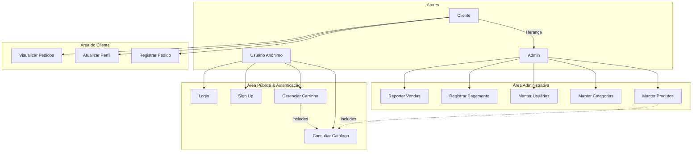
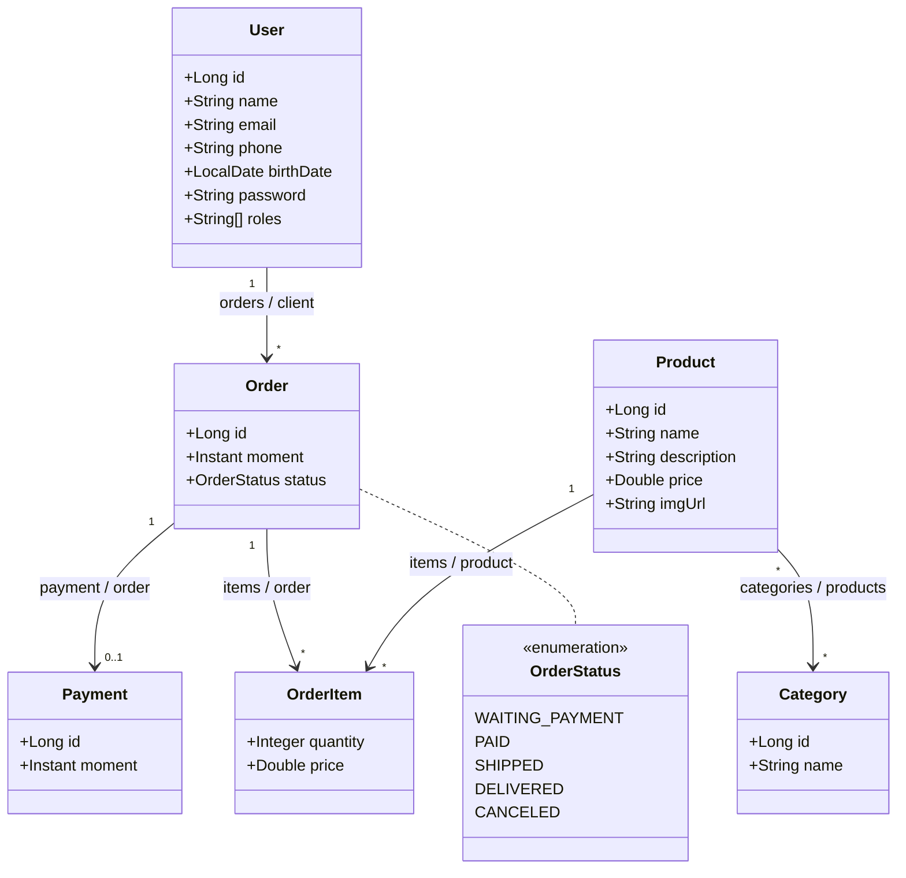

<div align="center">

[](./README.md)
[](./README.en.md)
[](./README.es.md)

[](https://github.com/ivanfsilva/dscommerce/releases)
[](https://github.com/ivanfsilva/dscommerce)
[](./LICENSE)

</div>

# 🛒 DSCommerce - Plataforma de E-Commerce

O **DSCommerce** é uma solução completa de comércio eletrônico (E-Commerce) desenvolvida como parte da formação corporativa backend em Java e Spring Boot. O sistema fornece uma arquitetura escalável e bem delimitada para gerenciar operações de compra e venda online, atendendo desde a navegação pública de produtos até a gestão administrativa de catálogo e fluxo financeiro de pedidos.

---

## 📌 Visão Geral & Conceitos-Chave

O **DSCommerce** resolve a complexidade do fluxo de vendas online separando claramente a experiência do cliente final da gestão administrativa da loja virtual.

### 💡 Funcionamento Geral do Sistema

1. **Navegação e Carrinho (Público):** Qualquer usuário anônimo pode consultar o catálogo de produtos com paginação e busca por nome, visualizar detalhes dos itens e montar seu carrinho de compras dinâmico (adicionando, alterando quantidades ou removendo produtos).
2. **Checkout e Pedido (Cliente Autenticado):** Ao decidir finalizar a compra, o usuário precisa estar autenticado no sistema. O pedido é registrado com o status inicial de `WAITING_PAYMENT` (Aguardando Pagamento), consolidando o _snapshot_ dos preços dos produtos no momento da transação.
3. **Gestão Administrativa (Admin):** Usuários administradores possuem privilégios para realizar a manutenção completa (CRUD) do cadastro de produtos, categorias e usuários, além de registrar pagamentos e emitir relatórios de vendas por período.

### 🏛️ Padrões Arquiteturais e Boas Práticas Aplicadas

- **Arquitetura em Camadas (Layered Architecture):** Rigorosa separação de responsabilidades entre as camadas de Apresentação/Controladores REST (`Controllers`), Regras de Negócio (`Services`) e Acesso a Dados (`Repositories`).
- **Transferência de Dados Segura (DTO Pattern):** Uso intensivo de _Data Transfer Objects_ para proteger as entidades de domínio JPA e encapsular a entrada e saída das requisições HTTP.
- **Modelo de Domínio Rico e Consistência Histórica:** Mapeamento de entidades com relacionamentos complexos ($1:N$, $N:N$). O preço unitário do item é persistido dentro da tabela de associação `OrderItem`, garantindo que eventuais alterações futuras no valor de tabela de um produto não alterem o histórico financeiro de pedidos já consolidados.
- **Segurança e Autorização Granular (RBAC - Role-Based Access Control):** Controle rigoroso de acesso com Spring Security e OAuth2/JWT, diferenciando perfis `ROLE_CLIENT` e `ROLE_ADMIN`.
- **Tratamento Centralizado de Exceções:** Uso de `@ControllerAdvice` para capturar exceções de negócio, validações de integridade relacional e erros de campo (_Bean Validation_), retornando respostas amigáveis e padronizadas no formato JSON.

---

## 🎨 Protótipos de Tela (Figma)

A concepção da interface do usuário e dos fluxos de navegação do **DSCommerce** foi desenhada previamente no Figma, englobando a área pública do e-commerce, o fluxo de carrinho/checkout e o painel administrativo.

- **Link para o Projeto no Figma:** [DSCommerce - Figma Prototypes](https://www.figma.com/file/ZrGNVNG0kZL6txDv4G8P6s/DSCommerce)

### Escopo das Telas Mapeadas:

- **Área Pública & Cliente:** Vitrine/Catálogo de Produtos, Detalhes do Produto, Carrinho de Compras, Tela de Login e Confirmação de Pedido.
- **Área Administrativa:** Listagem de Produtos (CRUD), Formulário de Cadastro/Edição de Produtos e Gestão de Categorias.

---

## 📋 Casos de Uso & Regras de Negócio

Abaixo está o detalhamento estruturado das funcionalidades e regras operacionais do sistema:

### 1. Área Pública (Usuário Anônimo / Cliente / Admin)

- **Consultar Catálogo:** Listagem paginada de produtos (padrão de 12 itens por página) ordenada por nome, permitindo filtro opcional por parte do nome.
- **Gerenciar Carrinho:** Permite adicionar produtos, remover itens e alterar quantidades. O sistema calcula dinamicamente os subtotais por item e o valor total do carrinho.
- **Login / Sign Up:** Permite o autocadastro de novos clientes (todo usuário cadastrado por padrão recebe o perfil `ROLE_CLIENT`) e a autenticação com geração de token de acesso.

### 2. Área do Cliente (Exige Autenticação)

- **Registrar Pedido:** Converte os itens do carrinho em um pedido salvo no sistema com status `WAITING_PAYMENT`.
  - _Regra de Negócio:_ O carrinho não pode estar vazio no momento do envio.
- **Visualizar Pedidos & Perfil:** Permite ao cliente consultar o histórico e detalhes dos seus próprios pedidos e atualizar seus dados cadastrais.

### 3. Área Administrativa (Exige Perfil `ROLE_ADMIN`)

- **Manter Produtos (CRUD):** Inserção, atualização e remoção de produtos no catálogo.
  - _Regras de Validação:_
    - **Nome:** Obrigatório, entre 3 e 80 caracteres.
    - **Preço:** Obrigatório e estritamente positivo ($> 0$).
    - **Descrição:** No mínimo 10 caracteres.
    - **Categorias:** O produto deve possuir pelo menos 1 categoria vinculada.
  - _Tratamento de Exceções:_ Impedimento de deleção caso o produto possua vínculo com pedidos (violação de integridade referencial).
- **Manter Categorias & Usuários:** Gestão cadastral de apoio às operações do e-commerce.
- **Registrar Pagamento:** Atualização do status do pedido para `PAID` (Pago) e registro do instante exato da confirmação de pagamento.
- **Reportar Vendas:** Emissão de relatórios consolidados de pedidos filtrados por intervalo de datas.

---

## 📐 Arquitetura & Diagramas

### Diagrama de Casos de Uso



### Modelo Conceitual / Diagrama de Classes



---

## 📋 Especificação de Entrada e Saída (Exemplos Práticos)

# Consultar Catálogo

## Exemplo de entrada e saída

### Entrada

`GET /products?name=Computer&page=0&size=12`

### Saída

```json
{
  "content": [
    {
      "id": 1,
      "name": "Computer",
      "price": 1100.0,
      "imgUrl": "https://raw.githubusercontent.com/devsuperior/dscatalog-resources/master/backend/img/1-big.png"
    }
  ],
  "pageable": {
    "pageNumber": 0,
    "pageSize": 12
  },
  "totalPages": 1,
  "totalElements": 1
}
```

---

# Manter Produtos (Inserir)

## Exemplo de entrada e saída

### Entrada

`POST /products`

```json
{
  "name": "Smart TV",
  "description": "Smart TV 55 polegadas 4K Ultra HD com comandos de voz",
  "price": 2500.0,
  "imgUrl": "https://raw.githubusercontent.com/devsuperior/dscatalog-resources/master/backend/img/tv.png",
  "categories": [
    {
      "id": 2
    }
  ]
}
```

### Saída

`Status: 201 Created`

```json
{
  "id": 15,
  "name": "Smart TV",
  "description": "Smart TV 55 polegadas 4K Ultra HD com comandos de voz",
  "price": 2500.0,
  "imgUrl": "https://raw.githubusercontent.com/devsuperior/dscatalog-resources/master/backend/img/tv.png",
  "categories": [
    {
      "id": 2,
      "name": "Eletrônicos"
    }
  ]
}
```

---

# Registrar Pedido

## Exemplo de entrada e saída

### Entrada

`POST /orders`

```json
{
  "items": [
    {
      "productId": 1,
      "quantity": 2
    },
    {
      "productId": 3,
      "quantity": 1
    }
  ]
}
```

### Saída

`Status: 201 Created`

```json
{
  "id": 102,
  "moment": "2026-10-31T11:05:00Z",
  "status": "WAITING_PAYMENT",
  "client": {
    "id": 1,
    "name": "Maria Brown",
    "email": "maria@gmail.com"
  },
  "payment": null,
  "items": [
    {
      "productId": 1,
      "name": "Computer",
      "price": 1100.0,
      "quantity": 2,
      "subTotal": 2200.0
    },
    {
      "productId": 3,
      "name": "Macbook Pro",
      "price": 1250.0,
      "quantity": 1,
      "subTotal": 1250.0
    }
  ],
  "total": 3450.0
}
```

---

## 🛠️ Tecnologias e Ferramentas

- **Linguagem & Framework:** Java 17 LTS, Spring Boot 3.x, Spring MVC, Spring Security (OAuth2 / JWT)
- **Build & Gerenciamento:** Apache Maven
- **Persistência & Banco de Dados:** Jakarta Persistence (JPA), Hibernate, H2 Database (Dev/Testes), PostgreSQL (Produção)
- **Validação & Testes:** Jakarta Bean Validation, JUnit 5, Mockito
- **Ferramentas de Produtividade:** Postman, Git, Figma

<br>

<div align="center">
  
  
  
  
  <br>
  
  
  
  <br>
  
  
  
  
</div>

---

## 📂 Estrutura de Pastas

```text
dscommerce/
├── src/
│   ├── main/
│   │   ├── java/
│   │   │   └── com/
│   │   │       └── devsuperior/
│   │   │           └── dscommerce/
│   │   │               ├── controllers/
│   │   │               │   ├── CategoryController.java
│   │   │               │   ├── OrderController.java
│   │   │               │   ├── ProductController.java
│   │   │               │   └── UserController.java
│   │   │               ├── dtos/
│   │   │               ├── entities/
│   │   │               │   ├── Category.java
│   │   │               │   ├── Order.java
│   │   │               │   ├── OrderItem.java
│   │   │               │   ├── OrderItemPK.java
│   │   │               │   ├── OrderStatus.java
│   │   │               │   ├── Payment.java
│   │   │               │   ├── Product.java
│   │   │               │   └── User.java
│   │   │               ├── repositories/
│   │   │               ├── services/
│   │   │               └── exceptions/
│   │   └── resources/
│   │       ├── application.properties
│   │       └── import.sql
│   └── test/
├── pom.xml
└── README.md
```

---

## 🚀 Como Executar o Projeto

1. **Clonar o repositório:**

   ```bash
   git clone https://github.com/ivanfsilva/dscommerce.git
   ```

2. **Navegar até a pasta raiz do projeto:**

   ```bash
   cd dscommerce
   ```

3. **Executar a aplicação via Maven:**

   ```bash
   mvn spring-boot:run
   ```

4. **Acessar os endpoints da API:**
   - A aplicação estará rodando em `http://localhost:8080`.
   - O console do banco H2 pode ser acessado em `http://localhost:8080/h2-console`.

---

## 📌 Próximos Passos (Roadmap)

> 💡 **Nota sobre o escopo:** A versão **v1.0.0-beta** consolida o _baseline_ backend (API RESTful) desenvolvido durante o treinamento da **DevSuperior**. A partir da versão **v2.0.0**, todas as _releases_ e evoluções representam **iniciativas 100% pessoais da minha autoria**, criadas para praticar e aprofundar meus conhecimentos em engenharia Full Stack — incluindo a construção de uma interface web dinâmica em React baseada nos protótipos do Figma.

| Versão                                                                                                                            | Descrição                                                                                                                                                                                                     |
| :-------------------------------------------------------------------------------------------------------------------------------- | :------------------------------------------------------------------------------------------------------------------------------------------------------------------------------------------------------------ |
| [](https://github.com/ivanfsilva/dscommerce) | **[Baseline DevSuperior]** Entrega da API RESTful backend completa: CRUDs, validações com Bean Validation, segurança OAuth2/JWT e regras de negócio de pedidos.                                               |
| [](#)                                                               | **[Prática Extra Autoral - Front-end React]** Construção da interface Single Page Application (SPA) em **React** consumindo a API backend, cobrindo telas de catálogo, carrinho e checkout baseadas no Figma. |
| [](#)                                                               | **[Prática Extra Autoral - Testes & Qualidade]** Ampliação da suíte automatizada de testes com JUnit 5, Mockito e RestAssured, com verificação de cobertura via JaCoCo.                                       |
| [](#)                                                               | **[Prática Extra Autoral - Documentação]** Integração e disponibilização de documentação interativa das APIs utilizando OpenAPI 3 / Swagger UI.                                                               |

---

## 👤 Autor

Desenvolvido por **Ivan Ferreira**.

Copyright © 2026 Ivan Ferreira. Todos os direitos reservados.

---

## ☕ Sobre

Aplicação prática construída no contexto do treinamento corporativo da plataforma ⚡**DevSuperior**, ministrada pelo Prof. Dr. Nélio Alves.
